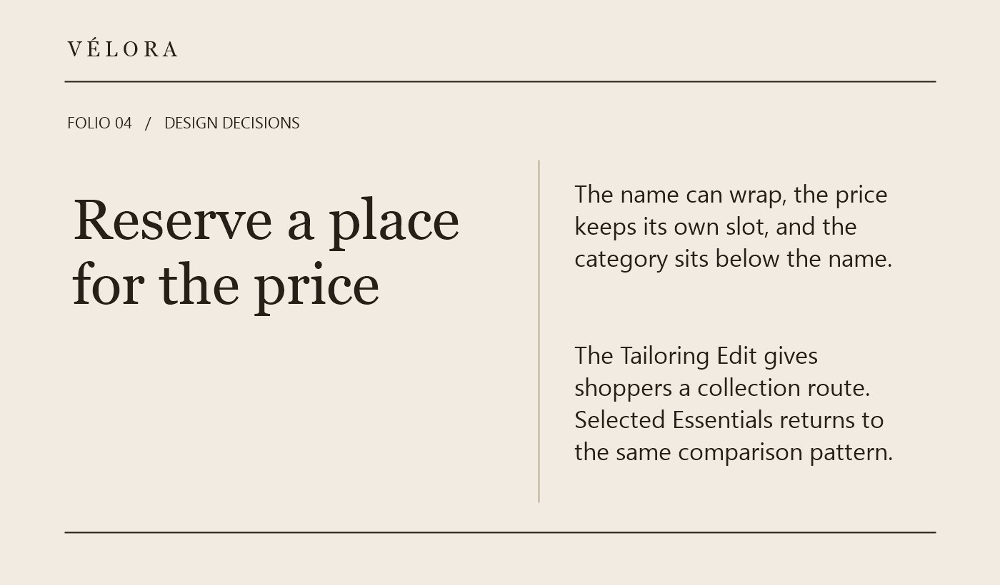
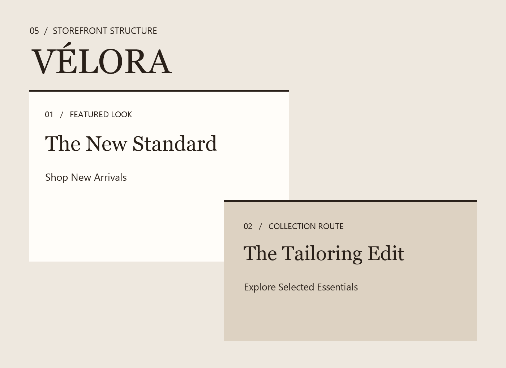

# VÉLORA | Editorial Fashion Storefront Concept

A self-initiated Figma concept for a 1280 px desktop fashion storefront, designed by Ahasanul Karim Khan. It explores moving from a featured look to individual garments and collection browsing.

[Read the Behance case study](https://www.behance.net/gallery/256963517/VELORA-Editorial-Fashion-Storefront-Concept) · [Design decisions](docs/design-decisions.md) · [Asset notes](docs/assets.md)

*Photo-free presentation cover, not a storefront screenshot.*

## My contribution

I designed the desktop storefront composition in Figma, including the editorial collection entry, New Arrivals and Selected Essentials product grids, and The Tailoring Edit collection route. The case study focuses on visual hierarchy, merchandise comparison and the path into a collection.

## Design approach

- Introduce the collection through a featured look and a shopping entry.
- Repeat a comparable product-card pattern in New Arrivals and Selected Essentials.
- Give longer garment names room to wrap beside a reserved price slot, with the category below the name.
- Offer The Tailoring Edit as a separate collection entry.

*Design-decision story panel, not a rendered product-card screenshot. Prices in the concept are illustrative.*

*Storefront structure diagram, not a UI screenshot or evidence of a working shopping flow.*

## Scope and evidence

This repository presents an existing desktop design concept through documentation and selected photo-free presentation assets. Mobile and tablet designs, product-detail pages, cart, checkout and website implementation are outside this package.

The local review records describe an isolated Figma long-name check: the revised name wrapped while the price stayed separate and the category sat below. That check does not establish production behavior or complete coverage of every product card. The selected images explain the design and do not show the full merchandise grid.

No client engagement, primary user research, usability testing, launch, conversion gains or measured business results are claimed. Public portfolio-use permission for the fashion photography remains undocumented, so photo-bearing exports are excluded. The private Figma source is not shared here.

## Repository contents

- `docs/design-decisions.md`: reasoning, revision evidence and limits.
- `docs/assets.md`: export provenance and exclusions.
- `assets/`: existing photo-free cover, story panel and layout diagram.

This repository grants no license for reuse of the design or third-party assets.
